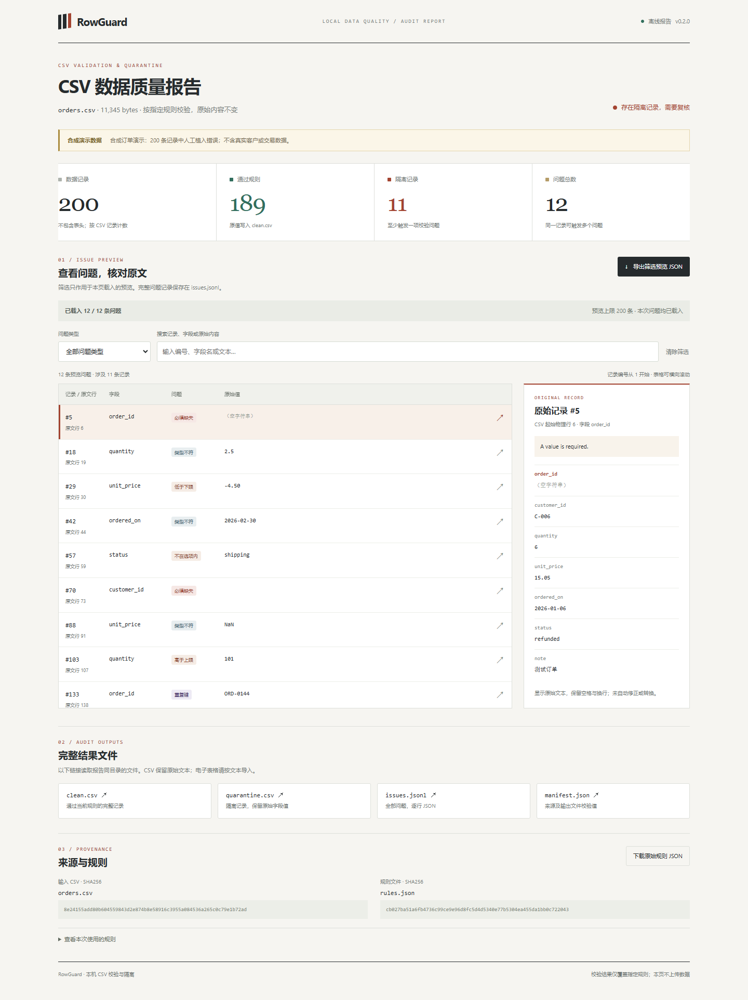

# RowGuard

用本地 JSON 规则检查 CSV，把符合规则的记录和问题记录分开，并生成可离线浏览的审核报告。重复键会隔离整个重复组，包括首次出现的记录。原始文件和单元格文本保持不变。

[在线合成示例](https://hyperammonemia.github.io/rowguard/) · [源代码](https://github.com/hyperammonemia/rowguard) · [自动测试](https://github.com/hyperammonemia/rowguard/actions)



## 试用

Python 3.10 或更高版本，运行工具只需要标准库。克隆或下载仓库后执行：

```sh
python rowguard.py data/orders.csv --rules data/rules.json --output runs/review-001
```

然后用浏览器打开 `runs/review-001/index.html`。输出目录必须是新目录；再次运行时换一个目录名。示例故意包含问题记录，所以命令正常生成报告后返回退出码 `1`。纯净输入返回 `0`，配置、输入格式或输出错误返回 `2`。

也可以安装本地包，使用同样参数调用 `rowguard`：

```sh
python -m pip install .
rowguard --version
```

下载仓库后直接打开 `docs/index.html` 即可查看保存的示例，无需安装 Python。HTML 内嵌样式、脚本与预览数据，处理和浏览过程不向服务器上传 CSV。

## 为什么隔离整个重复组

只拒绝第二条重复记录会默认相信第一条。RowGuard 将原始记录暂存在 SQLite，读取完整输入后寻找重复键，让所有重复成员进入 `quarantine.csv`。其他字段已出错的记录仍参与重复检查；一个记录可以有多个问题，但隔离行数只计一次。

它帮助你在导入数据库或分析前定位问题，输出不会自动修正字段。`clean.csv` 只表示通过本次规则，不代表数据符合所有业务要求或现实事实。

## 规则与输入范围

完整例子见 [data/rules.json](data/rules.json)。规则是本项目的小型配置格式，版本为 `1`。

| 配置 | 含义 |
| --- | --- |
| `columns` | 字段名到检查规则的映射；CSV 表头必须恰好包含这些字段，顺序可以不同 |
| `type` | `string`、`integer`、`number` 或严格的 `YYYY-MM-DD` 日期；默认 `string` |
| `required` | 空字符串或仅含空白的值视为缺失；默认 `false` |
| `min` / `max` | 数值类型的上下限；数值比较使用 Decimal，拒绝 NaN 和无穷值 |
| `choices` | 字符串字段的非空候选列表，按原始文本比较 |
| `unique` | 唯一键列表，支持组合键，如 `[["order_id", "region"]]` |

唯一键按原始文本比较，因此 `001` 与 `1` 不相同；任一键字段为空白时跳过该重复检查，是否允许为空由 `required` 决定。可选字段为空时跳过类型、范围和候选值检查。数值检查允许周边空白，日期必须是精确格式，输出不会写回转换后的值。

输入为 UTF-8 CSV，可有 BOM，支持引号、逗号和引号内换行。重复表头、缺列、多列、损坏的 CSV 及未知规则字段会报错。当前默认上限为 250,000 条数据记录、100 MiB 输入、128 列和每个单元格 1 MiB；这只是处理边界，没有大文件吞吐量基准。工具不读取 Excel 工作簿，也不自动猜测编码或分隔符。

## 输出与溯源

| 文件 | 内容 |
| --- | --- |
| `clean.csv` | 通过全部规则的记录，保留原列顺序、行顺序与单元格文本 |
| `quarantine.csv` | 至少有一个问题的记录，保留原值 |
| `issues.jsonl` | 全量问题；含数据记录号、起始物理行号、字段、规则及原始行 |
| `report.json` | 汇总、规则原文、来源哈希及有上限的问题预览 |
| `index.html` | 离线报告，可筛选问题、检查原始行及导出当前预览 |
| `manifest.json` | 输入、规则与输出文件的 SHA256，供核对来源和文件变化 |

记录号从第一条数据记为 `1`；物理行号包含表头与引号内换行。页面默认最多展示 200 条问题，完整问题在 `issues.jsonl`。筛选和页面导出的 JSON 只覆盖预览范围；汇总始终描述完整输入。可用 `--preview-limit` 调整预览上限。

复用检查规则时，使用 `report.json` 中的 `rules.source_text` 原文，它保留高精度数值阈值。`rules.definition` 是方便浏览的解析映射，普通 JSON 数字解析可能对高精度小数舍入。

CSV 输出保留原始文本，包括可能被电子表格解释成公式的内容；需要表格软件查看时按文本导入。HTML 将字段作为文本显示。已有输出目录会被拒绝，生成失败不会发布半成品目录。相同输入和规则可以得到相同的结果文件。

## 核对收到的报告

0.2.0 新增只读校验命令。收到一份结果目录后，用其中的 `manifest.json` 核对文件；如有原始 CSV 和规则文件，也可以一起核对：

```sh
python -m rowguard_verify docs --input data/orders.csv --rules data/rules.json
```

这里的 `docs` 是仓库保存的合成示例，换成自己的结果目录即可。安装本地包后也可以运行 `rowguard-verify`，参数相同。旧版 0.1.0 生成的清单也能检查。

命令输出 JSON，列出各文件的预期 SHA256、实际 SHA256 和核对状态。退出码 `0` 表示本次请求的检查全部匹配，`1` 表示有文件缺失或不匹配，`2` 表示清单无效或文件无法检查。未提供 `--input` 或 `--rules` 时，对应来源会明确标为未检查；文件名不同不影响内容核对。

该命令只读取文件，不修复或重新生成清单。它能发现文件与清单不一致，不能证明作者身份，也不能证明清单本身可信。若文件和清单被一起改写，校验仍可能通过；需要从可信的 Git 提交或发送方取得清单。通过校验也不代表 CSV 符合业务事实。

## 可复现的合成示例

[generate_demo.py](generate_demo.py) 生成 200 条合成订单，并在固定记录中植入缺失、非法数值、日期错误、范围错误及重复键。没有真实客户或交易数据。独立预期保存在 [data/expected.json](data/expected.json)。

示例应得到 189 条通过记录、11 条隔离记录、12 个问题。第 133 与 144 条拥有相同订单号，两条都会隔离；第 180 条同时违反数量下限和状态候选规则。这些数字用于检查程序行为，不代表业务数据质量或外部准确率。

```sh
python generate_demo.py
python build_demo.py
python build_demo.py --check
python -m unittest discover -s tests -v
```

`build_demo.py` 独立核对预期记录集合，并逐单元格比较输出与原始 CSV。`--check` 检查保存的结果与重新运行是否逐字节一致。GitHub Actions 在 Python 3.10 和 3.14 上运行检查，并用 Chromium 检查离线页面；运行结果以 Actions 页面为准。

```sh
npm install --ignore-scripts
npx playwright install chromium
npm run test:ui
```

浏览器检查可通过 `BROWSER_PATH` 使用本机 Chrome。Playwright 只用于开发检查，不是工具的运行依赖。

## 实际分工

这是 AI 协作个人项目。用户提出并委托项目，OpenAI Codex 执行方案细化、实现、合成数据生成、测试和发布。没有企业试用、外部用户效果或独立业务验收记录。代码和随仓库生成的合成数据使用 [MIT 许可证](LICENSE)。
